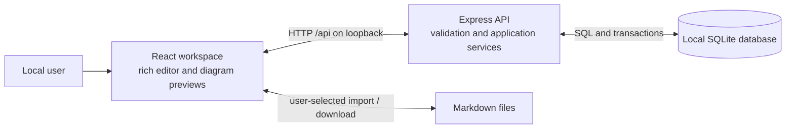

# Architecture

**Implementation state:** T01 supplies the TypeScript workspace scaffold, a React connection page, and an Express health endpoint. Note functionality and persistence are not implemented. Consequential choices have individual statuses in the [decision register](#decision-status-and-evidence); validation applies only to the scope recorded for each choice.

The system supports the [product requirements](requirements.md): one person writes rich notes in a browser, organizes them in folders, and keeps saved content on their own computer. Individual documents in [roadmaps](../roadmaps/) define feature or release designs, detailed requirements, acceptance criteria, tasks, and verification evidence. The user specifies which roadmap governs the work.

This document owns enduring technical decisions and their rationale, including persistence, save coordination, and rendering rules. Roadmaps link to those rules and own release-specific behavior and acceptance checks. Once implemented, shared runtime schemas own exact document/API contracts and package manifests own commands; keep this design aligned with them rather than maintaining competing specifications.

## System boundary

The required stack is Node.js, TypeScript, Express, SQLite, and React. A local browser talks to a local Node.js process; that process owns the database. There is no account service, collaboration server, cloud storage, or separate database service.

Markdown crosses the system boundary only through explicit import/export. SQLite documents remain the source of truth. Mermaid source is stored with the note; rendering happens in the browser.

## Components and responsibilities

The proposed repository uses npm workspaces with three packages:

| Component         | Responsibility                                                                                                                                    | Boundary                                                                        |
| ----------------- | ------------------------------------------------------------------------------------------------------------------------------------------------- | ------------------------------------------------------------------------------- |
| `apps/web`        | React navigation, editor, save coordination, Markdown conversion, and Mermaid previews. Vite supplies development tooling and the frontend build. | Calls the API; never accesses SQLite or imports server-only modules.            |
| `apps/server`     | Express routes, input validation, hierarchy and revision rules, SQLite access, migrations, and production static serving.                         | Owns all persisted changes and validates them independently of the browser.     |
| `packages/shared` | Portable runtime schemas and inferred TypeScript types for documents and API data.                                                                | Contains no database access, server dependencies, or DOM-dependent editor code. |

Keep HTTP handlers focused on transport and validation. Application services enforce editing and hierarchy rules; repositories execute parameterized SQL and transactions. The browser loads tree metadata separately from full note bodies so navigation does not fetch every document.

The API covers tree metadata, note detail, and note/folder creation, updates, moves, and deletion. Shared schemas will define the exact routes, payloads, and errors during implementation. Errors must distinguish invalid input, missing resources, invalid hierarchy changes, and revision conflicts without exposing database details or note content.

## Persistence and document model

| Record | Stored information                                                                                                |
| ------ | ----------------------------------------------------------------------------------------------------------------- |
| Folder | ID, name, optional parent folder ID, creation/update timestamps.                                                  |
| Note   | ID, title, optional folder ID, rich document JSON, document schema version, revision, creation/update timestamps. |

A null parent/folder represents the workspace root. IDs identify resources independently of their names or locations.

Rich JSON is canonical because the editor needs structured blocks and marks. Markdown is a conversion format: it preserves the supported content set and Mermaid source, but cannot promise exact source whitespace or arbitrary rich formatting. Version the stored document schema so incompatible content is detected rather than silently misread.

Finalize editor-specific validation during the compatibility spike, then validate it through the real API and reopened database before treating the integrated document API as stable. The initial release's [compatibility checkpoint](../roadmaps/initial-project.md#editor-and-backend-compatibility-checkpoint) defines ownership, checks, and required reruns.

Use `better-sqlite3`, foreign keys, WAL, a busy timeout, and ordered SQL migrations as the proposed storage implementation. Index parent references for hierarchy queries. SQLite suits a single local process and avoids operating another service. Its synchronous access is a simple fit for this workload; long-running work must stay out of request transactions.

Enforce valid parents and reject cycles in the service layer. Validate and apply hierarchy changes in one transaction. Folder deletion removes descendants and notes atomically. Persist note changes only when their expected revision matches, incrementing that revision in the same write. Never reset an existing database to recover from a migration error.

## Editing, saving, and conversion

### Rich editing

The proposed editor is open-source Tiptap with `@tiptap/markdown`, chosen for extensible rich blocks and local Markdown conversion. Verify the full supported block set and custom Mermaid conversion before committing the rest of the interface to it.

Represent a diagram as a dedicated block containing plain Mermaid source. Custom conversion hooks map that block to and from fenced `mermaid` Markdown. The editor extension set, conversion adapters, and server document validator must accept the same document structure.

### Save lifecycle

1. Load the selected note and its revision into the editor. Keep pending title/body changes locally.
2. After 750 ms without edits, queue a save. Serialize writes per note; newer edits made during a request remain pending.
3. On success, acknowledge only the submitted snapshot and revision. An older response must not replace newer edits, undo a rename/move, or update a different selected note.
4. Before switching notes or discarding the active document, flush pending changes. If saving fails, retain the editor and offer retry.
5. On a revision conflict, retain local content until the user explicitly reloads or saves it as a new note.

Reset undo history between notes. A dirty-tab warning helps with ordinary closure; it is not crash recovery or version history.

### Markdown and diagrams

Import converts a selected Markdown file into a validated document before creating a new note. Export flushes pending edits before converting the saved document and downloading it. Conversion failures must not create partial notes or destroy existing content.

The selected roadmap defines supported constructs and the user-visible policy for unsupported imports. For the initial release, see [R6](../roadmaps/initial-project.md#r6--import-and-export-markdown); conversion adapters must enforce that policy before any note is created.

Render Mermaid asynchronously with unique diagram IDs and per-block request versions. Discard stale results after another edit or note switch, clean up temporary rendering elements, and preserve source on failure. Bound input/rendering complexity so pathological diagrams cannot monopolize the writing interface.

Treat imported content as untrusted even in a local app: disable arbitrary HTML rendering and reject unsafe link protocols. Initialize Mermaid with `securityLevel: 'strict'` and `startOnLoad: false`; disable diagram-supplied configuration overrides and arbitrary HTML labels. Diagram-provided configuration must not weaken these safeguards.

## Local runtime and operations

In development, Vite serves the frontend and proxies API requests. In production, Express serves the built frontend and API from loopback. Unknown API paths must remain API errors rather than returning the frontend fallback page. The editor, Markdown conversion, and diagrams must not require runtime CDN or cloud access.

Because the app has no authentication, keep it bound to loopback, validate browser origins for writes, and avoid permissive CORS. Public exposure would require a different security design.

Store SQLite files in a configurable local data directory excluded from Git. Startup initializes the directory and applies migrations; shutdown closes the connection. Report inaccessible paths, locks, and migration failures without deleting existing content. Backup/restore instructions must account for SQLite sidecar files; the initial operational guidance will use a stopped server.

The scaffold targets Node.js 24 LTS and ESM throughout. Shared code compiles to a portable package before either app. Development can run in separate terminals with `npm run dev:backend` and `npm run dev:frontend`; the backend command owns the shared watcher, while the frontend command builds shared code once at startup. `npm run dev` also starts the shared watcher and both apps together. Vite uses 127.0.0.1:5173 and proxies /api to Express on 127.0.0.1:3001 by default. The root .env can override PORT for Express and its development proxy. Production serves the built frontend and health API from Express. See the [README](../README.md) for setup and command details. Data paths, migrations, write-origin checks, and operational hardening remain work for T03, T05, and T14.

## Design validation and remaining risks

| Risk or unresolved detail                   | Validation needed                                                                                                                          |
| ------------------------------------------- | ------------------------------------------------------------------------------------------------------------------------------------------ |
| Tiptap, Markdown, and Mermaid compatibility | Round-trip representative blocks and diagrams; keep the document schema aligned across browser and API.                                    |
| Node.js and native SQLite compatibility     | Select supported versions and verify installation on Windows before recording prerequisites.                                               |
| Save races and competing tabs               | Exercise in-flight edits, delayed responses, navigation, retry, and revision conflicts against the real API.                               |
| Invalid or expensive diagrams               | Test syntax failures, complexity limits, stale render cleanup, and hostile content.                                                        |
| API and input rules                         | Establish exact contracts, name rules, and compatible request/import limits in shared schemas with boundary tests.                         |
| Local configuration and persistence         | Verify the default data path, configuration, migration rollback, and reopen/restart behavior before documenting them as operational facts. |

Use Vitest for isolated logic, Supertest with temporary SQLite databases for API/persistence behavior, and Playwright for browser workflows. ESLint, Prettier, and strict TypeScript provide scaffold quality checks. Package manifests own their commands; later tasks extend behavioral verification.

### Scaffold tooling choices

T01 uses TypeScript 5.9 because the selected TypeScript ESLint integration supports versions below 6.1. The root minimatch override selects the patched 11.x line for GHSA-g3hv-75wg-m249; lint and typechecks pass with it. npm 12 install-script rules allow the pinned esbuild setup script and deny an unnecessary better-sqlite3 source build. SQLite 13 ships native prebuilds, and the scaffold test loads its Windows binary against Node.js 24.18.0. These are tooling choices, not validation of persistence or the editor.

## Decision status and evidence

Track consequential choices in the register below, with rationale and consequences in their linked sections. Product-mandated stack constraints remain requirements, not choices awaiting validation.

- `proposed`: Intended choice, not yet implemented and checked for its stated scope. Link to the owning validation task; pending evidence is not proof.
- `validated`: Implemented and verified for an explicit scope. Link to implementation and tests, plus recorded verification evidence with the date, commands/scenarios, outcomes, and relevant environment or limitations. A code link or completed task alone is insufficient.
- `superseded`: Replaced choice. Retain a brief record of its rationale, replacement link, and reason/consequences; add the replacement with its own status.

Update the relevant row when a task supplies evidence. If a material change invalidates that evidence, return the current choice to `proposed` until rechecked; preserve the earlier evidence as history. A validated choice does not imply that other choices or the whole application are validated. Introduce separate decision records only when their history warrants them.

| Choice and rationale                                                        | Status      | Validation / evidence                                                                                                                                                                                                                                                                                                                                                                                       |
| --------------------------------------------------------------------------- | ----------- | ----------------------------------------------------------------------------------------------------------------------------------------------------------------------------------------------------------------------------------------------------------------------------------------------------------------------------------------------------------------------------------------------------------- |
| [Workspace and shared-module boundaries](#components-and-responsibilities)  | `proposed`  | Scaffold verified in [T01 evidence](../roadmaps/initial-project.md#t01) on 2026-11-07: ESM builds and shared imports resolve in both apps on Windows/Node 24.18.0. Contract boundaries remain pending [T02](../roadmaps/initial-project.md#t02).                                                                                                                                                            |
| [SQLite storage and versioned documents](#persistence-and-document-model)   | `proposed`  | Pending: [T03](../roadmaps/initial-project.md#t03), [T04](../roadmaps/initial-project.md#t04), [compatibility checkpoint](../roadmaps/initial-project.md#editor-and-backend-compatibility-checkpoint).                                                                                                                                                                                                      |
| [Tiptap and custom Mermaid conversion](#rich-editing)                       | `proposed`  | Pending: [T06](../roadmaps/initial-project.md#t06), [T09](../roadmaps/initial-project.md#t09).                                                                                                                                                                                                                                                                                                              |
| [Save coordination and revision recovery](#save-lifecycle)                  | `proposed`  | Pending: [T11](../roadmaps/initial-project.md#t11).                                                                                                                                                                                                                                                                                                                                                         |
| [Markdown conversion and safe diagram rendering](#markdown-and-diagrams)    | `proposed`  | Pending: [T06](../roadmaps/initial-project.md#t06), [T10](../roadmaps/initial-project.md#t10), [T12](../roadmaps/initial-project.md#t12).                                                                                                                                                                                                                                                                   |
| [Loopback runtime and local data operations](#local-runtime-and-operations) | `proposed`  | Pending: [T05](../roadmaps/initial-project.md#t05), [T14](../roadmaps/initial-project.md#t14).                                                                                                                                                                                                                                                                                                              |
| [Verification tooling](#design-validation-and-remaining-risks)              | `validated` | Scaffold scope only, 2026-11-07, Windows 11 x64 / Node 24.18.0 / npm 12.2.2: clean install, strict typechecks, ESLint, Prettier, two Vitest/Supertest/native SQLite checks, Chromium proxy smoke, and builds pass. See [T01 evidence](../roadmaps/initial-project.md#t01) and [scaffold tests](../apps/server/src/app.test.ts). Release workflows remain pending [T15](../roadmaps/initial-project.md#t15). |
