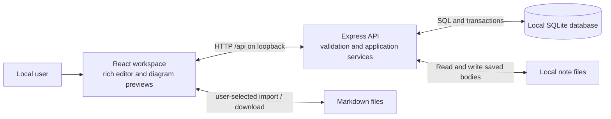

# Architecture

**Implementation state:** The React workspace implements folder navigation, breadcrumbs, rich writing with formatting/slash controls, editable Mermaid previews, coordinated title/body autosave, navigation flushing, conflict recovery, Markdown file import/export, and create/rename/move/delete controls. Native dialogs preserve failed-operation state and confirm permanent deletion or local reload. SQLite migrations, transactional services, revision checks, protected REST routes, and built production serving are implemented. Keyboard/accessibility review and production/restart checks pass for the recorded scope; the [roadmap](../roadmaps/initial-project.md) owns final acceptance evidence and the PR review status. Consequential choices have scoped statuses in the [decision register](decisions/README.md).

The system supports the [product requirements](requirements.md): one person writes rich notes in a browser, organizes them in folders, and keeps saved content on their own computer. Individual documents in [roadmaps](../roadmaps/) define feature or release designs, detailed requirements, acceptance criteria, tasks, and verification evidence. The user specifies which roadmap governs the work.

This document is the system overview and navigation index. Topic pages own the current technical design; module READMEs explain local interfaces and invariants. Decision records explain choices and alternatives. Roadmaps own release requirements, acceptance tasks, and verification history. Runtime schemas own exact document/API contracts, and package manifests own commands.

## System boundary

The required stack is Node.js, TypeScript, Express, SQLite, and React. A local browser talks to a local Node.js process; that process owns the database. There is no account service, collaboration server, cloud storage, or separate database service.

Raw Markdown crosses the API boundary as each note's content. The server stores the body in a Markdown file and keeps its relative path and metadata in SQLite. Rich editor conversion and rendering happen in the browser. Mermaid source remains in fenced Markdown blocks. See [the canonical storage decision](decisions/0003-raw-markdown.md).

## Components and responsibilities

The repository uses npm workspaces with three packages:

| Component            | Responsibility                                                                                                                                    | Boundary                                                                        |
| -------------------- | ------------------------------------------------------------------------------------------------------------------------------------------------- | ------------------------------------------------------------------------------- |
| `apps/web`           | React navigation, editor, save coordination, Markdown conversion, and Mermaid previews. Vite supplies development tooling and the frontend build. | Calls the API; never accesses SQLite or imports server-only modules.            |
| `apps/server`        | Express routes, input validation, hierarchy and revision rules, SQLite access, migrations, and production static serving.                         | Owns all persisted changes and validates them independently of the browser.     |
| `packages/contracts` | Portable runtime schemas and inferred TypeScript types for documents and API data.                                                                | Contains no database access, server dependencies, or DOM-dependent editor code. |

Keep HTTP handlers focused on transport and validation. The [workspace README](../apps/server/src/workspace/README.md) explains the persistence service and its boundaries. The browser loads tree metadata separately from full note bodies so navigation does not fetch every document.

The API implements health, tree metadata, note detail, and note/folder creation, updates, moves, and deletion. The [shared schemas](../packages/contracts/src/index.ts) define routes, payloads, limits, and errors, described in [API contracts](api.md). The [HTTP adapters](../apps/server/src/http/workspace.ts) call an injected workspace service; the app factory never opens SQLite itself. Errors distinguish invalid input, missing resources, invalid hierarchy changes, and revision conflicts without exposing database details or note content. Unknown API paths remain JSON 404 responses.

## Architecture topics

| Document                                                      | Owns                                                              |
| ------------------------------------------------------------- | ----------------------------------------------------------------- |
| [Persistence and document model](architecture/persistence.md) | Record layout, storage configuration, and migrations              |
| [Workspace services](../apps/server/src/workspace/README.md)  | Module interfaces, validation, mutations, revisions, and tests    |
| [Workspace navigation](architecture/navigation.md)            | Client validation, ordering, selection, reading, and title saves  |
| [Editing, saving, and conversion](architecture/editor.md)     | Editor structure, save ordering, Markdown, and diagram safety     |
| [Local runtime and operations](architecture/runtime.md)       | Source imports, builds, loopback runtime, local data, and tooling |
| [Technical decisions](decisions/README.md)                    | Choice status, rationale, alternatives, and verification evidence |
| [API contracts](api.md)                                       | Exact routes, schemas, names, limits, and errors                  |

Feature/release requirements and acceptance tasks stay in [roadmaps](../roadmaps/). Add feature documentation when there is a distinct user guide or cross-release behavior to explain; an empty or competing docs/features tree would not help this release.

## Design validation and remaining risks

| Boundary                            | Evidence and remaining limits                                                                                                                                                                                                                                                                                       |
| ----------------------------------- | ------------------------------------------------------------------------------------------------------------------------------------------------------------------------------------------------------------------------------------------------------------------------------------------------------------------- |
| Markdown and editor compatibility   | [T09](../roadmaps/initial-project.md#t09) verifies editor/API/reopen compatibility; [T12](../roadmaps/initial-project.md#t12) verifies UTF-8 file round trips and supported rich edits. Unsupported source stays in a safe read-only fallback.                                                                      |
| Node.js and native SQLite           | Windows 11 x64 / Node 24.18.0 / npm 12.2.2 installation and native loading are checked. Other platforms are not verified by this release's evidence.                                                                                                                                                                |
| Save races and competing tabs       | [T11](../roadmaps/initial-project.md#t11) covers in-flight edits, ordered revisions, retry, navigation, and two-tab recovery. There is no crash recovery; unacknowledged creates lack idempotency.                                                                                                                  |
| Invalid or expensive diagrams       | [T10](../roadmaps/initial-project.md#t10) checks safe previews, limits, and stale cleanup. Already-running synchronous layout cannot be interrupted; large lazy vendor chunks remain.                                                                                                                               |
| API and input rules                 | Shared schemas and real HTTP/SQLite checks enforce names, Unicode/byte limits, hierarchy transactions, revision conflicts, and loopback origin rules. This is a single-user boundary without authentication.                                                                                                        |
| Local configuration and persistence | Migration rollback/reopen, clean configuration failures, [production restart](../roadmaps/initial-project.md#t14), and [stopped-server backup/restore](architecture/runtime.md#data-directory-and-backup) use isolated real databases. Hot backups and incompatible future versions are outside the verified scope. |
| Accessible interaction              | [T13](../roadmaps/initial-project.md#t13) checks Chromium keyboard operation, names/status, native dialog focus, and desktop/320px layout. It is not a complete WCAG or screen-reader certification.                                                                                                                |
