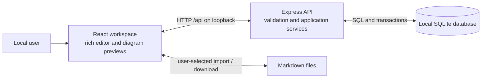

# Architecture

**Implementation state:** The TypeScript workspace supplies a React connection page, portable API contracts, and raw Markdown validation. SQLite initialization, versioned migrations, database shutdown, folder/note services, HTTP transport protections, and health/tree/note-detail GET routes are implemented. HTTP mutations and the rich editor UI remain pending. Consequential choices have individual statuses in the [decision register](decisions/README.md); validation applies only to the scope recorded for each choice.

The system supports the [product requirements](requirements.md): one person writes rich notes in a browser, organizes them in folders, and keeps saved content on their own computer. Individual documents in [roadmaps](../roadmaps/) define feature or release designs, detailed requirements, acceptance criteria, tasks, and verification evidence. The user specifies which roadmap governs the work.

This document is the system overview and navigation index. Topic pages own the current technical design; module READMEs explain local interfaces and invariants. Decision records explain choices and alternatives. Roadmaps own release requirements, acceptance tasks, and verification history. Runtime schemas own exact document/API contracts, and package manifests own commands.

## System boundary

The required stack is Node.js, TypeScript, Express, SQLite, and React. A local browser talks to a local Node.js process; that process owns the database. There is no account service, collaboration server, cloud storage, or separate database service.

Raw Markdown crosses the API boundary as each note's content and is stored in SQLite. Rich editor conversion and rendering happen in the browser. Mermaid source remains in fenced Markdown blocks. See [the canonical storage decision](decisions/0003-raw-markdown.md).

## Components and responsibilities

The repository uses npm workspaces with three packages:

| Component            | Responsibility                                                                                                                                    | Boundary                                                                        |
| -------------------- | ------------------------------------------------------------------------------------------------------------------------------------------------- | ------------------------------------------------------------------------------- |
| `apps/web`           | React navigation, editor, save coordination, Markdown conversion, and Mermaid previews. Vite supplies development tooling and the frontend build. | Calls the API; never accesses SQLite or imports server-only modules.            |
| `apps/server`        | Express routes, input validation, hierarchy and revision rules, SQLite access, migrations, and production static serving.                         | Owns all persisted changes and validates them independently of the browser.     |
| `packages/contracts` | Portable runtime schemas and inferred TypeScript types for documents and API data.                                                                | Contains no database access, server dependencies, or DOM-dependent editor code. |

Keep HTTP handlers focused on transport and validation. The [workspace README](../apps/server/src/workspace/README.md) explains the persistence service and its boundaries. The browser loads tree metadata separately from full note bodies so navigation does not fetch every document.

The API covers tree metadata, note detail, and note/folder creation, updates, moves, and deletion. The [shared schemas](../packages/contracts/src/index.ts) define routes, payloads, limits, and errors, described in [API contracts](api.md). Health, tree metadata, note detail, and JSON API 404 handling run over HTTP; T05 still owns mutation handlers. The app factory requires an injected workspace service and never opens SQLite itself. Errors distinguish invalid input, missing resources, invalid hierarchy changes, and revision conflicts without exposing database details or note content.

## Architecture topics

| Document                                                      | Owns                                                              |
| ------------------------------------------------------------- | ----------------------------------------------------------------- |
| [Persistence and document model](architecture/persistence.md) | Record layout, storage configuration, and migrations              |
| [Workspace services](../apps/server/src/workspace/README.md)  | Module interfaces, validation, mutations, revisions, and tests    |
| [Editing, saving, and conversion](architecture/editor.md)     | Editor structure, save ordering, Markdown, and diagram safety     |
| [Local runtime and operations](architecture/runtime.md)       | Source imports, builds, loopback runtime, local data, and tooling |
| [Technical decisions](decisions/README.md)                    | Choice status, rationale, alternatives, and verification evidence |
| [API contracts](api.md)                                       | Exact routes, schemas, names, limits, and errors                  |

Feature/release requirements and acceptance tasks stay in [roadmaps](../roadmaps/). Add feature documentation when there is a distinct user guide or cross-release behavior to explain; an empty or competing docs/features tree would not help this release.

## Design validation and remaining risks

| Risk or unresolved detail                   | Validation needed                                                                                                                          |
| ------------------------------------------- | ------------------------------------------------------------------------------------------------------------------------------------------ |
| Tiptap, Markdown, and Mermaid compatibility | Round-trip representative blocks and diagrams; keep the document schema aligned across browser and API.                                    |
| Node.js and native SQLite compatibility     | Select supported versions and verify installation on Windows before recording prerequisites.                                               |
| Save races and competing tabs               | Exercise in-flight edits, delayed responses, navigation, retry, and revision conflicts against the real API.                               |
| Invalid or expensive diagrams               | Test syntax failures, complexity limits, stale render cleanup, and hostile content.                                                        |
| API and input rules                         | Establish exact contracts, name rules, and compatible request/import limits in shared schemas with boundary tests.                         |
| Local configuration and persistence         | Verify the default data path, configuration, migration rollback, and reopen/restart behavior before documenting them as operational facts. |
