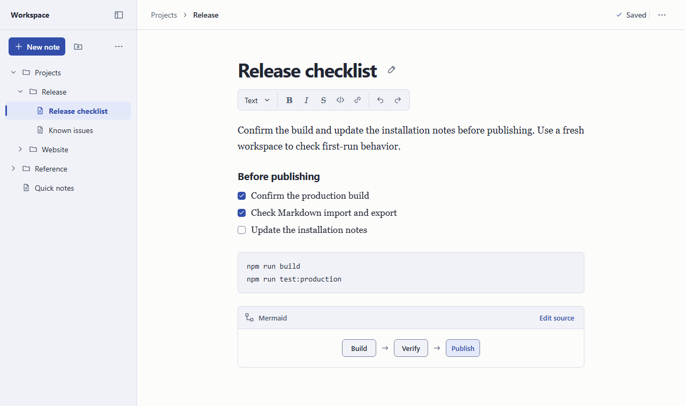
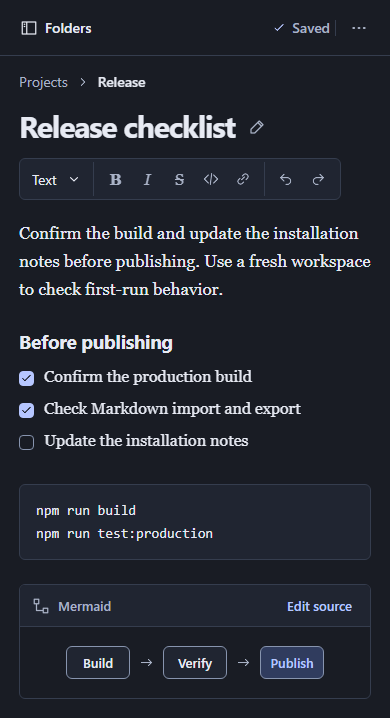

# Editor UI redesign

**Status** · Proposed for review

Give the note a centered writing column, make folders easy to scan, and keep save status visible while scrolling. Take cues from MarkText’s single editing canvas and Obsidian’s compact file explorer. Reuse the current editor, Markdown conversion, save coordinator, API, and local storage. [MarkText](https://github.com/marktext/marktext#features) · [Obsidian](https://obsidian.md/help/plugins/file-explorer) · [Product requirements](../docs/requirements.md)

## Mockups

### Desktop · light theme

### Mobile · dark theme

## Design

- **Explorer.** Use a 256 px sidebar with independent scrolling. Put **New note** and **New folder** above the tree. Group import and refresh under **Workspace actions**. Highlight the current note and expand its ancestors.
- **Header.** Keep breadcrumbs, save status, and **Note actions** within reach. Group save, rename, move, export, and delete in that menu. Keep **Edit title** beside the title. Use folder actions and a direct-child list in folder views.
- **Editor.** Center prose at about 66 characters per line. Align the title, compact toolbar, and body. Keep slash insertion, keyboard shortcuts, Mermaid editing, and the selectable Markdown fallback. Give empty folders a **New note** action.
- **Save recovery.** Show saved, unsaved, and saving states in the sticky header. When a save fails or conflicts, link the header status to the existing retry or recovery controls.
- **Mobile.** At 760 px and below, start with the explorer closed. **Folders** opens a scrollable panel and moves focus into it. Escape or close returns focus to the toggle. Selecting a note moves focus to the content after a successful load. At 320 px, wrap titles and controls and contain wide code and diagrams.
- **Style.** Follow the system theme. Use Instrument Sans for controls and titles, Spectral for prose, and IBM Plex Mono for code. Use shared styles for dialogs, menus, and editor blocks. Give icon buttons accessible names and visible focus.

| Color            | Light     | Dark      |
| ---------------- | --------- | --------- |
| Writing surface  | `#FCFCFA` | `#191C24` |
| Explorer         | `#F0F2F7` | `#202531` |
| Text             | `#212634` | `#E7EAF3` |
| Accent and focus | `#324EAA` | `#B6C6FF` |
| Selected row     | `#E4E9FA` | `#303C5E` |

## Implementation

| Task                     | Status | Done when                                                                                                                                                                                                                                                                                          |
| ------------------------ | ------ | -------------------------------------------------------------------------------------------------------------------------------------------------------------------------------------------------------------------------------------------------------------------------------------------------- |
| **T01 · Visual system**  | `todo` | • Capture baseline screenshots with synthetic notes • Add shared colors and local fonts • Check 4.5:1 text contrast and 3:1 focus and essential control contrast                                                                                                                             |
| **T02 · Workspace**      | `todo` | • Build the explorer, header, and action menus • Test keyboard navigation and focus return • Check action targets and delete confirmation • Run these checks on desktop and at 320 px                                                                                                     |
| **T03 · Editor**         | `todo` | • Apply the writing layout • Restyle dialogs, Mermaid, and source fallback • Verify formatting preserves selection • Verify explorer toggles preserve drafts and undo history                                                                                                             |
| **T04 · Release checks** | `todo` | • Compare screenshots in both themes • Test slow and failed saves, retries, and conflicts with isolated SQLite • Test navigation and export with unsaved edits in that workspace • Check that untouched Markdown exports byte-for-byte • Check that layout changes send no note writes |

Run the repository’s formatting, type, lint, unit, browser, build, and production checks. Record results and any remaining limits here. [Repository checks](../README.md#checks)

## Verification

### T01 · Visual system

Captured four baseline screenshots using synthetic checklist/code/Mermaid notes in isolated SQLite at 1280 px and 320 px in both system themes (`.cache/ui-baseline/`, ignored). `editor-appearance.spec.ts` regenerates the corresponding current screenshots in `test-results/`; generated images are not committed. Fonts are installed packages bundled by Vite, with no runtime font CDN.

Shared tokens cover surfaces, text, focus, controls, dialogs, recovery, and editor blocks. WCAG relative-luminance calculations across writing, explorer, and selected-row backgrounds give minimum text/muted/accent contrast of 12.46/5.12/6.18 in light and 9.03/5.10/6.47 in dark. Essential control borders use a separate darker token; focus uses the accent. Type checking passes. Remaining repository and interaction checks are recorded with T04.

### T02 · Workspace

Implemented the explorer, sticky context header, scoped action disclosures, and empty-folder creation. Keyboard checks at 1280 px and 320 px verify explorer focus/return, menu traversal, modal cancellation, and no writes during those interactions. A failed mobile note load leaves the explorer available; a successful retry closes it and focuses content. Existing real API/SQLite lifecycle checks verify action targets, revision conflicts, deletion cancellation/confirmation, and failed-operation retention. Focused navigation, lifecycle, and export runs pass, including an export that drains newer edits during a delayed save. The complete suite is recorded with T04.

### T03 · Editor

Implemented the centered prose column, aligned title/edit control, compact named formatting icons, shared vector icons, and themed dialogs, source fallback, and Mermaid blocks. Diagram rendering uses application-owned theme tokens while retaining the strict input/SVG safety boundary. System-theme changes discard obsolete previews without editing their source.

Fourteen focused browser checks pass: screenshots in both themes/widths, draft/undo preservation across explorer toggles/resizing/theme changes, slash insertion, formatting/link selection and focus, and safe source fallback. The mounted toolbar unit test passes with accessible-name queries. Additional accessibility/renderer checks passed (16 of 17 in the first combined run); a save-button timing assumption in the long slash test was corrected and that scenario passes in the 14-test rerun. Final screenshots and complete checks follow in T04.
